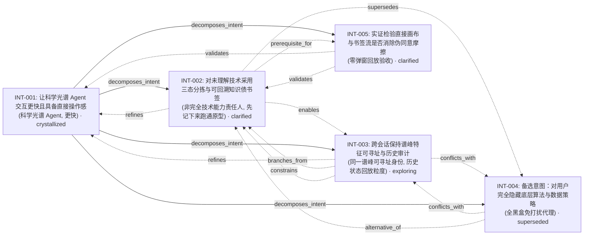

# Intent Graph (Epistemic Layer)

Generated by `scripts/ptm.py`; edit `_aiHumanInteract/intent/nodes/*.md` instead.

## Intents & Concepts

| ID | Intent | Status | Key Concepts | Plans | KD Bookmarks |
|---|---|---|---|---|---|
| `INT-001` | [让科学光谱 Agent 交互更快且具备直接操作感](../nodes/INT-001.md) | `crystallized` | 科学光谱 Agent (anchored); 更快 (resolved) | LT-001, WP-001 | KD-003 |
| `INT-002` | [对未理解技术采用三态分拣与可回溯知识债书签](../nodes/INT-002.md) | `clarified` | 非完全技术能力责任人 (resolved); 先记下来跑通原型 (resolved) | MT-001, WP-002, WP-003 | KD-001 |
| `INT-003` | [跨会话保持谱峰特征可寻址与历史审计](../nodes/INT-003.md) | `exploring` | 同一谱峰可寻址身份 (resolved); 历史状态回放粒度 (ambiguous) | MT-002, WP-004, WP-005 | KD-002 |
| `INT-004` | [备选意图：对用户完全隐藏底层算法与数据策略](../nodes/INT-004.md) | `superseded` | 全黑盒免打扰代理 (resolved) | WP-003 | — |
| `INT-005` | [实证检验直接画布与书签流是否消除伪同意摩擦](../nodes/INT-005.md) | `clarified` | 零弹窗回放验收 (resolved) | WP-006 | — |
