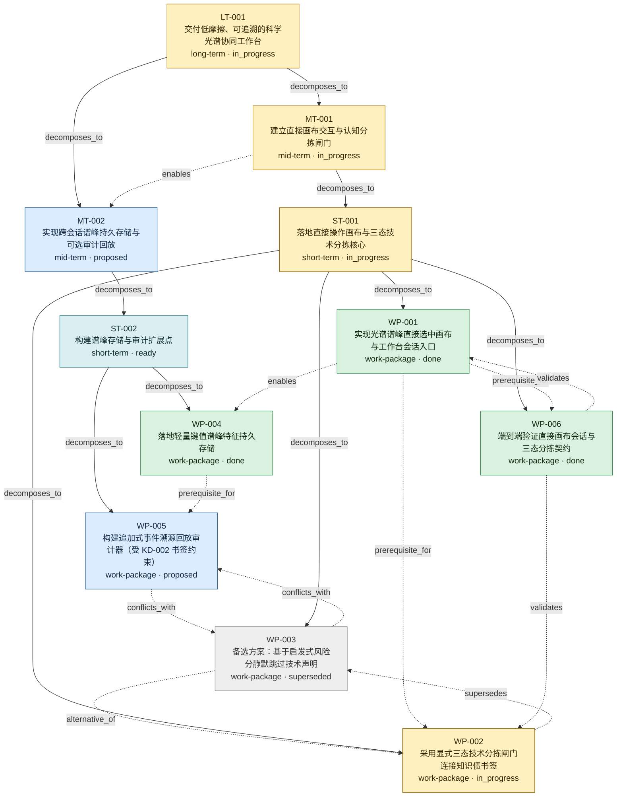

# Plan Graph

Generated by `../build_graph.py`; edit source nodes in the four level
directories and rebuild instead of editing this file.

## Plan index

### long-term

| ID | Plan | Status | Parent | Alternative of | Depends on | Updated |
|---|---|---|---|---|---|---|
| `LT-001` | [交付低摩擦、可追溯的科学光谱协同工作台](../long-term/LT-001.md) | `in_progress` | — | — | — | 2026-11-24 |

### mid-term

| ID | Plan | Status | Parent | Alternative of | Depends on | Updated |
|---|---|---|---|---|---|---|
| `MT-001` | [建立直接画布交互与认知分拣闸门](../mid-term/MT-001.md) | `in_progress` | LT-001 | — | — | 2026-11-24 |
| `MT-002` | [实现跨会话谱峰持久存储与可选审计回放](../mid-term/MT-002.md) | `proposed` | LT-001 | — | — | 2026-11-24 |

### short-term

| ID | Plan | Status | Parent | Alternative of | Depends on | Updated |
|---|---|---|---|---|---|---|
| `ST-001` | [落地直接操作画布与三态技术分拣核心](../short-term/ST-001.md) | `in_progress` | MT-001 | — | — | 2026-11-24 |
| `ST-002` | [构建谱峰存储与审计扩展点](../short-term/ST-002.md) | `ready` | MT-002 | — | — | 2026-11-24 |

### work-package

| ID | Plan | Status | Parent | Alternative of | Depends on | Updated |
|---|---|---|---|---|---|---|
| `WP-001` | [实现光谱谱峰直接选中画布与工作台会话入口](../work-package/WP-001.md) | `done` | ST-001 | — | — | 2026-11-24 |
| `WP-002` | [采用显式三态技术分拣闸门连接知识债书签](../work-package/WP-002.md) | `in_progress` | ST-001 | — | WP-001 | 2026-11-24 |
| `WP-003` | [备选方案：基于启发式风险分静默跳过技术声明](../work-package/WP-003.md) | `superseded` | ST-001 | WP-002 | — | 2026-11-24 |
| `WP-004` | [落地轻量键值谱峰特征持久存储](../work-package/WP-004.md) | `done` | ST-002 | — | — | 2026-11-24 |
| `WP-005` | [构建追加式事件溯源回放审计器（受 KD-002 书签约束）](../work-package/WP-005.md) | `proposed` | ST-002 | — | WP-004 | 2026-11-24 |
| `WP-006` | [端到端验证直接画布会话与三态分拣契约](../work-package/WP-006.md) | `done` | ST-001 | — | WP-001 | 2026-11-24 |

## Typed edge summary

| Relationship | Count |
|---|---:|
| `alternative_of` | 1 |
| `conflicts_with` | 2 |
| `decomposes_to` | 10 |
| `enables` | 2 |
| `prerequisite_for` | 3 |
| `supersedes` | 1 |
| `validates` | 2 |
