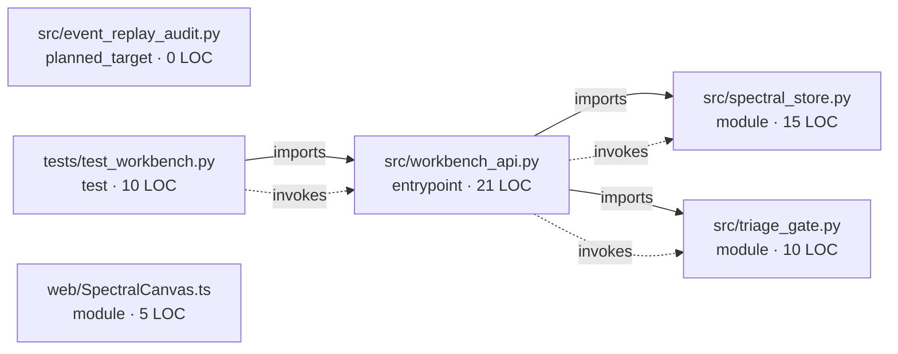

# Scripts Graph (Codebase Structure & Coverage)

Generated from repository source AST & static analysis by `scripts/ptm.py`.

## Module Inventory (Ranked by Structural Centrality)

| Path | Language | Role | Status | LOC | Centrality | Plans | Summary |
|---|---|---|---|---:|---:|---|---|
| `src/workbench_api.py` | `python` | `entrypoint` | `clean` | 21 | 1.000 | LT-001, WP-001, WP-006 | Main workbench entrypoint coordinating spectral features and non-blocking triage. |
| `src/spectral_store.py` | `python` | `module` | `clean` | 15 | 0.966 | MT-002, ST-002, WP-004 | Persistent addressable store for spectral peak features and annotations. |
| `src/triage_gate.py` | `python` | `module` | `clean` | 10 | 0.966 | MT-001, ST-001, WP-002, WP-006 | Three-way technical disclosure gate and reversible prototype scope checker. |
| `src/event_replay_audit.py` | `python` | `planned_target` | `planned_missing` | 0 | 0.540 | MT-002, ST-002, WP-005 | Planned in Plan/Spec Graph; file not yet created on disk. |
| `tests/test_workbench.py` | `python` | `test` | `clean` | 10 | 0.540 | WP-001, WP-004, WP-006 | Verify spectral workbench session and 3-way technical triage. |
| `web/SpectralCanvas.ts` | `typescript` | `module` | `clean` | 5 | 0.540 | MT-001, ST-001, WP-001 | Direct-manipulation spectral feature canvas without modal interruptions |
