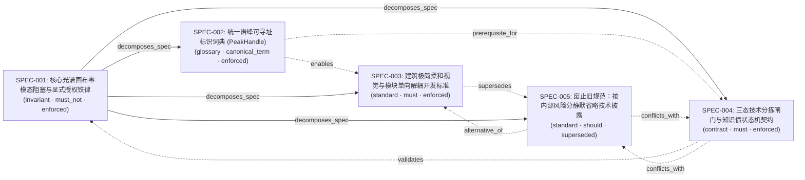

# Spec Graph (Standing Laws, Ubiquitous Language & Contracts)

Generated by `scripts/ptm.py`; edit `_aiHumanInteract/specs/nodes/*.md` instead.

## Normative Specifications

| ID | Spec | Kind | Enforcement | Status | Intents | Plans | Governs Scripts | Verified By |
|---|---|---|---|---|---|---|---|---|
| `SPEC-001` | [核心光谱画布零模态阻塞与显式授权铁律](../nodes/SPEC-001.md) | `invariant` | `must_not` | `enforced` | INT-001, INT-002 | LT-001, WP-001, WP-002 | web/SpectralCanvas.ts, src/workbench_api.py | tests/test_workbench.py |
| `SPEC-002` | [统一谱峰可寻址标识词典 (PeakHandle)](../nodes/SPEC-002.md) | `glossary` | `canonical_term` | `enforced` | INT-003 | MT-002, WP-004 | src/spectral_store.py, web/SpectralCanvas.ts | tests/test_workbench.py |
| `SPEC-003` | [建筑极简柔和视觉与模块单向解耦开发标准](../nodes/SPEC-003.md) | `standard` | `must` | `enforced` | INT-001 | MT-001, ST-001 | web/SpectralCanvas.ts, src/spectral_store.py, src/triage_gate.py | — |
| `SPEC-004` | [三态技术分拣闸门与知识债状态机契约](../nodes/SPEC-004.md) | `contract` | `must` | `enforced` | INT-002, INT-005 | WP-002, WP-006 | src/triage_gate.py, src/workbench_api.py | tests/test_workbench.py |
| `SPEC-005` | [废止旧规范：按内部风险分静默省略技术披露](../nodes/SPEC-005.md) | `standard` | `should` | `superseded` | INT-004 | WP-003 | — | — |
