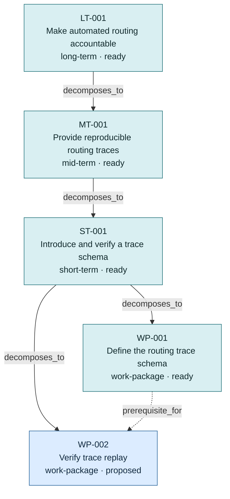

# Plan Graph

Generated by `../build_graph.py`; edit source nodes in the four level
directories and rebuild instead of editing this file.

## Plan index

### long-term

| ID | Plan | Status | Parent | Alternative of | Depends on | Updated |
|---|---|---|---|---|---|---|
| `LT-001` | [Make automated routing accountable](../long-term/LT-001.md) | `ready` | — | — | — | 2026-09-15 |

### mid-term

| ID | Plan | Status | Parent | Alternative of | Depends on | Updated |
|---|---|---|---|---|---|---|
| `MT-001` | [Provide reproducible routing traces](../mid-term/MT-001.md) | `ready` | LT-001 | — | — | 2026-09-15 |

### short-term

| ID | Plan | Status | Parent | Alternative of | Depends on | Updated |
|---|---|---|---|---|---|---|
| `ST-001` | [Introduce and verify a trace schema](../short-term/ST-001.md) | `ready` | MT-001 | — | — | 2026-09-15 |

### work-package

| ID | Plan | Status | Parent | Alternative of | Depends on | Updated |
|---|---|---|---|---|---|---|
| `WP-001` | [Define the routing trace schema](../work-package/WP-001.md) | `ready` | ST-001 | — | — | 2026-09-15 |
| `WP-002` | [Verify trace replay](../work-package/WP-002.md) | `proposed` | ST-001 | — | WP-001 | 2026-09-15 |

## Typed edge summary

| Relationship | Count |
|---|---:|
| `decomposes_to` | 4 |
| `prerequisite_for` | 1 |
