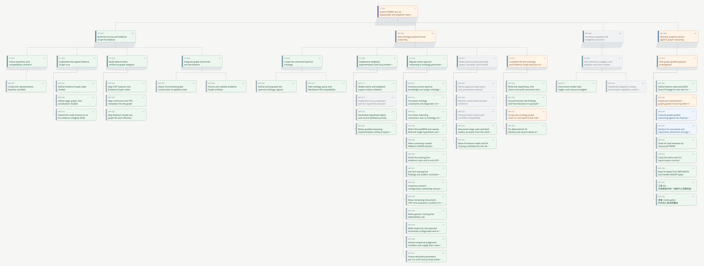

# Plan tree 2.5D viewer (experiment)

> **Frozen prototype.** The production renderer now lives in
> `assets/plan-graph/_aiHumanInteract/plan/plan_view.py` and writes
> `structure/graph.html` as a standard generated view. This folder is kept for
> design reference; do not fix production behavior here.

An experimental renderer for the Plan Graph. It is **not** part of the installed
bundle, and `build_graph.py` does not call it. It exists so the layout can be
reviewed and adjusted before deciding whether anything graduates into the
standard generated views.



## What this is

A tidy containment tree of the four Plan Graph levels (`LT → MT → ST → WP`),
drawn as an SVG with a fixed oblique projection:

```text
z:  LT 72 · MT 48 · ST 24 · WP 0
screen_x = x + z * 0.45
screen_y = y - z
```

Each card gets a ground shadow and, when `z > 0`, an extruded side face down to
its ground footprint. Cards stay front-facing, so labels remain readable. The visual treatment
follows the 2026-11-12 palette review: muted status borders, neutral gray
extrusion, a lighter canvas, and word-aware wrapping.

Implemented in `tree_layout.py`:

- one root or a forest; children sorted by ID for deterministic rebuilds;
- every subtree owns a contiguous span; a parent is centred over its first and
  last child;
- a run of three or more consecutive leaf siblings is stacked into an indented
  column instead of fanning out;
- parent-child connectors only; a stacked leaf owns the full path from its
  parent down the shared spine, so selecting it highlights exactly that route;
- status chips filter the tree (multi-select) by dimming the rest under a
  translucent shade and raising matching cards; 全选 clears the filter; a
  filtered-out selection closes the panel;
- click a node to open a scrollable detail panel (full title, objective,
  deliverables, acceptance, links, evidence); `Esc` closes it; the URL hash
  deep-links to a node;
- selection draws a light-blue halo and raises the ancestor chain's connectors
  into a top layer.

## Input

`input/graph.json` is a snapshot of the FORMA plan graph (64 nodes, 163 typed
edges, `schema_version: paths-to-modernity-plan-graph-v4`). `input/plans/`
contains the matching Markdown sources, for reading the node content. Both were
copied from the FORMA repository on 2026-11-12; they are a frozen snapshot, not
a maintained copy.

## Run

```bash
python3 tree_layout.py input/graph.json output --direction down --title "FORMA plan tree"
```

That writes `output/tree.html`, `output/tree.svg`, and
`output/tree.layout.json`. Open `tree.html` directly in a browser; it has no
network dependencies. `--direction right` lays generations out along x instead
of y (useful for a tall, narrow reading).

Regenerating the PNG needs a rasterizer; the checked-in file was produced with
`sharp` from the standalone SVG:

```bash
node -e "require('sharp')('output/tree.svg',{density:144}).flatten({background:'#F6F6F4'}).png().toFile('output/tree.png')"
```

## Layout knobs

| Constant | Current | Effect |
|---|---|---|
| `LEVEL_Z` | 48 / 32 / 16 / 0 | height of each level; larger means stronger steps |
| `DEPTH_X` | 0.35 | horizontal shift per z unit |
| `GAP_X` | 56 | horizontal gap between sibling subtrees |
| `PARENT_CHILD_GAP` | 64 | vertical gap between generations |
| `LEAF_GAP` | 16 | gap inside a stacked leaf column |
| `NODE_W` / `NODE_H` | 240 / 68 | card size |

## Known limits

- Only parent-child connectors are drawn; the 163 typed edges are not rendered.
- Node labels wrap at word boundaries for Latin and at any character for CJK,
  then truncate to two lines; the full text is in the detail panel and the
  native hover title.
- The projection is fixed. There is no orbit or camera; rotating the view would
  need a different rendering stack.
- No collapse, search, or status filters yet.
- `input/plans/` keeps the original repository-relative links, which do not
  resolve inside this folder.
